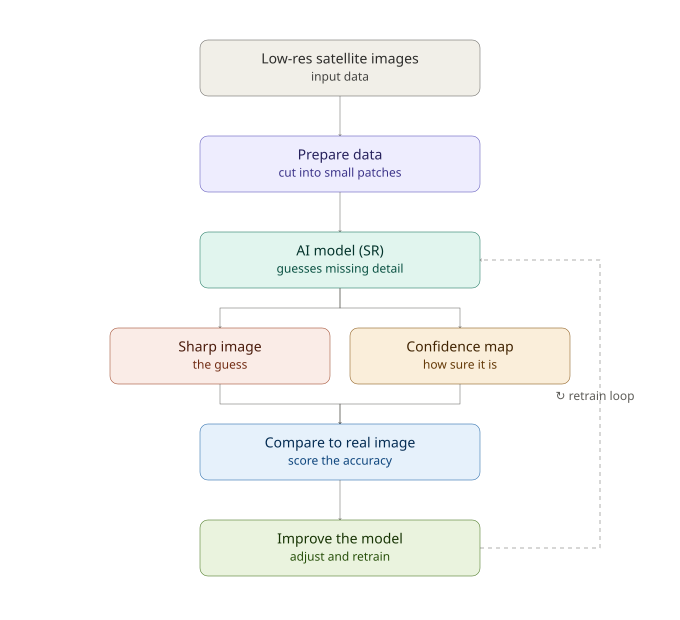

# Satellite Image Super-Resolution for Air Pollution Monitoring

Semester project — a scoped-down, computer-vision-focused piece of a larger physics-informed machine learning (PIML) research effort led by [Professor Name], on estimating high-resolution satellite-based PM2.5 pollution maps.

## The idea, in short

Satellite instruments that measure air pollution (like PM2.5) only give us blurry, low-resolution maps — often around 10km resolution. That's not detailed enough to spot things like pollution spikes along a specific highway. Our project uses AI-based super-resolution (SR) — the same kind of technique used to sharpen blurry photos — to turn these coarse satellite pollution maps into sharper, higher-resolution ones.

The bigger research project (see `docs/proposal/`) eventually wants to make this SR model "physics-informed" — teaching it the actual laws of how pollution moves through the atmosphere. That part requires atmospheric transport data we don't have yet. So:

- **Phase 1 (this semester, this repo's current scope):** build and evaluate a plain data-driven SR model. No physics/chemistry.
- **Phase 2 (next 1–2 months, after this semester):** add physics-informed constraints (PDE-based transport equations) once we get the required data from the environmental science department.

## Pipeline (Phase 1)



1. **Low-res satellite images** — our input data (satellite AOD / pollution imagery)
2. **Prepare data** — cut into small patches for training
3. **AI model (SR)** — the actual super-resolution step; guesses the missing fine detail
4. **Two outputs:**
   - **Sharp image** — the model's best guess at the high-res version
   - **Confidence map** — how sure the model is about each part of that guess (our uncertainty-aware add-on — most SR projects skip this)
5. **Compare to real image** — score the guess against real ground-truth data (EPA ground stations)
6. **Improve the model** — retrain and repeat

## What makes this more than a standard SR project

- **Uncertainty quantification:** the model doesn't just output a sharpened image, it also flags where it's unsure — important since this feeds into public health research, where a confidently wrong pixel is worse than a blurry one.
- **Task-driven evaluation:** beyond standard image-quality metrics (PSNR/SSIM), we evaluate whether the sharpened output actually helps identify real pollution patterns (e.g. against EPA ground station readings), not just whether it looks sharp.

## Repository structure

```
├── README.md                  # this file
├── docs/
│   ├── diagrams/               # pipeline & architecture diagrams
│   └── proposal/               # proposal doc (from Overleaf), timeline, task distribution
├── papers/
│   └── references.md           # key papers this project builds on
├── src/                        # code (data pipeline, model, training, evaluation)
└── data/                       # (gitignored) local data — not committed to the repo
```

## Data sources

- **MAIAC AOD** (Aerosol Optical Depth) — NASA Earthdata, ~1km resolution
- **EPA ground-based PM2.5 monitoring stations** — EPA AirNow / AQS API, Dallas–Fort Worth region
- Region: Dallas–Fort Worth (DFW), matching the parent project's scope

## Team & timeline

See `docs/proposal/` for the full proposal, timeline, and task distribution.

## Status

🚧 Phase 1 in progress.
