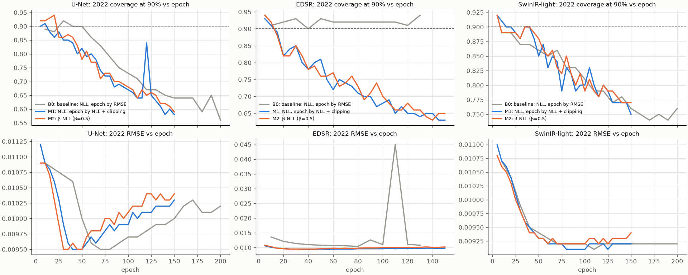
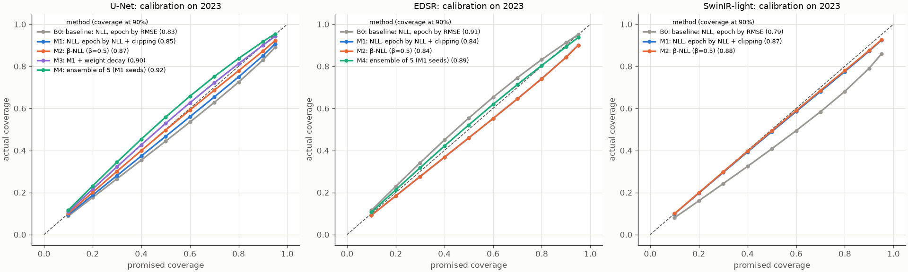
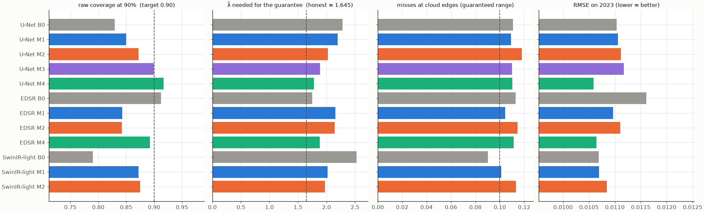

# RQ3: which way of measuring uncertainty works best, and how to stop overconfidence

**Short answer:**
- **Stopping training on 2022 NLL instead of RMSE removes most of the overconfidence.** SwinIR-light goes from 79% to 87% coverage at "90% sure" (target 90%), and calibration error drops from 0.083 to 0.014.
- **A deep ensemble of 5 models (M4) is the best method overall.** It has the lowest RMSE, NLL and λ̂ (closest to honest), the highest rank correlation, and the narrowest guaranteed range.
- **β-NLL and weight decay add nothing we can measure beyond seed noise.**
- **No method fixes the misses at cloud edges** (about 10–12% for every method), so the λ̂ calibration from RQ3(b) is still needed for the guarantee.

The original runs (**B0**) are kept unchanged as the comparison row.

Rules for every run: train on 2018–21, choose the epoch and λ̂ on **2022 only**, score on **2023 once**.
Code: [src/rq3_compare_methods.py](../src/rq3_compare_methods.py), runner [runs/methods/run_all.ps1](../runs/methods/run_all.ps1), logs in `runs/methods/`.

---

## 1. Why the original models were overconfident

- **Bottom row:** accuracy on 2022 (RMSE) stops improving around epoch 30–75.
- **Top row:** coverage keeps falling long after that, e.g. U-Net 0.90 → 0.56 by epoch 200. The net keeps shrinking σ̂ to fit the **training years** better, so on new years it says "sure" too often.
- **B0 picked its epoch by RMSE only.** RMSE is almost flat late in training, so it often picked a late epoch where σ̂ had already shrunk too far. SwinIR's B0 epoch, for example, sits where coverage is about 0.77.
- **EDSR B0 blew up** around epoch 110 (the RMSE spike in the middle panel). Gradient clipping (M1/M2) removed that: the blue and orange lines stay flat.
- **β-NLL (orange) does not stop the drift.** Its coverage falls about as fast as plain NLL (blue). The fix is **when** you stop, not the loss.

## 2. Methods tested

| ID | What changes | Idea / source |
|---|---|---|
| **B0** | Original: Gaussian NLL, epoch picked by 2022 RMSE, 200 epochs | baseline (kept) |
| **M1** | Epoch picked by **2022 NLL** (a score that includes σ̂), gradient clipping 1.0, 150 epochs | early stopping on the right score |
| **M2** | M1 + **β-NLL** (β = 0.5) | Seitzer et al. 2022 |
| **M3** | M1 + **weight decay** 1e-4 (AdamW), U-Net only | standard regularization |
| **M4** | **Deep ensemble**: 5 copies of M1 with different seeds. ŷ = mean of the 5; σ² = mean σ̂² + spread of the 5 ŷ | Lakshminarayanan et al. 2017 |
| **+λ** | Any of the above + the RQ3(b) calibration ŷ ± λ̂·σ̂ (λ̂ fitted on 2022) | conformal risk control |

All models use the plain setup (no average-back rule), same as the main RQ3 rows. SwinIR got M1 and M2 only, because 5 SwinIR runs were too slow.

## 3. Results on 2023

| Model | Method | RMSE ↓ | Raw coverage90 (target 0.90) | Cal. error ↓ | NLL ↓ | Rank corr σ̂ vs error ↑ | λ̂ (honest = 1.645) | Guaranteed width ↓ | Guaranteed misses (all) | Misses: cloud edges ↓ | Misses: high AOD ↓ |
|---|---|---|---|---|---|---|---|---|---|---|---|
| U-Net | B0 | 0.0110 | 0.830 | 0.052 | -3.303 | 0.44 | 2.28 | 0.0333 | 7.0% | 11.1% | 13.4% |
| U-Net | M1 | 0.0111 | 0.850 | 0.033 | -3.348 | 0.45 | 2.20 | 0.0340 | 6.6% | 10.9% | 10.8% |
| U-Net | M2 | 0.0111 | 0.872 | **0.011** | -3.354 | 0.45 | 2.03 | 0.0327 | 7.1% | 11.8% | 12.7% |
| U-Net | M3 | 0.0112 | **0.900** | 0.017 | -3.368 | 0.45 | 1.88 | 0.0340 | 6.6% | 11.0% | 10.8% |
| U-Net | **M4** | **0.0106** | 0.917 | 0.037 | **-3.443** | **0.47** | **1.78** | **0.0321** | 6.4% | 11.0% | **9.7%** |
| EDSR | B0 | 0.0116 | 0.912 | 0.033 | -3.273 | 0.41 | 1.75 | 0.0357 | 7.2% | 11.3% | 11.7% |
| EDSR | M1 | 0.0110 | 0.843 | 0.039 | -3.333 | 0.45 | 2.15 | 0.0332 | 7.4% | **10.4%** | 12.3% |
| EDSR | M2 | 0.0111 | 0.842 | 0.039 | -3.305 | 0.44 | 2.14 | 0.0325 | 7.7% | 11.5% | 13.0% |
| EDSR | **M4** | **0.0106** | **0.892** | **0.014** | **-3.427** | **0.46** | 1.88 | **0.0316** | 7.2% | 11.1% | **11.2%** |
| SwinIR-light | B0 | 0.0107 | 0.791 | 0.083 | -3.301 | **0.47** | 2.53 | 0.0338 | 6.8% | **9.0%** | **9.5%** |
| SwinIR-light | M1 | 0.0107 | 0.872 | 0.014 | **-3.414** | 0.46 | 2.02 | 0.0330 | 6.9% | 10.1% | **9.5%** |
| SwinIR-light | M2 | 0.0108 | **0.875** | **0.011** | -3.389 | 0.45 | **1.97** | **0.0321** | 7.3% | 11.3% | 10.3% |

"Guaranteed" means the range ŷ ± λ̂·σ̂. Every method stays under the 10% target on 2023 (6.4–7.7% misses), so the guarantee holds for all of them.

Above: closer to the dashed diagonal is more honest. For U-Net and SwinIR, every new method sits closer to it than B0 (grey). EDSR B0 was already close, because EDSR happened to be honest at its RMSE-picked epoch. EDSR's M1/M2 picked earlier, more accurate epochs (20–30) that are slightly overconfident.

## 4. How much is noise? (seed check)

The ensemble needed 5 seeds of M1, which also tells us how much a single run varies. Raw coverage90 on 2023 for each single model:

| | seed 0 | seed 1 | seed 2 | seed 3 | seed 4 |
|---|---|---|---|---|---|
| U-Net M1 | 0.85 | 0.90 | 0.88 | 0.88 | 0.88 |
| EDSR M1 | 0.84 | 0.85 | 0.85 | 0.85 | 0.87 |

- A single U-Net M1 run lands anywhere from 0.85 to 0.90. So **M2 (0.87) and M3 (0.90) are inside the seed noise**: we can't claim β-NLL or weight decay help.
- The B0 → M1 gap is bigger than this noise for SwinIR (0.79 → 0.87) and U-Net (0.83 → 0.85–0.90). That improvement is real.
- The ensemble's gains in RMSE (0.0110 → 0.0106) and λ̂ show up for both U-Net and EDSR. Averaging 5 models is a known effect, not luck.

## 5. Which method is best?

These criteria were set before looking at the 2023 numbers:

1. **RMSE no worse than B0 (within 2%).** All methods pass. M4 is better by 4% (U-Net) and 9% (EDSR).
2. **Raw honesty** (coverage90 near 0.90, low calibration error).
   - M4 EDSR is the best single row (0.892, 0.014).
   - M4 U-Net slightly **over**-covers (0.917). That is the safe direction, but its calibration error is 0.037.
   - For SwinIR, M1 and M2 tie (0.87, cal error ≈ 0.01).
3. **Guaranteed range: narrowest, fewest hard-pixel misses.**
   - M4 has the narrowest width for both models, and the fewest high-AOD misses on U-Net (13.4% → 9.7%).
   - Cloud-edge misses barely move (10–12% for every method).
4. **Rank correlation σ̂ vs error:** M4 is highest or tied (0.46–0.47). The differences are small.

**Winner: M4, the deep ensemble (5 × M1).** It is the only method that improves accuracy, honesty and the guaranteed range together.
- Adding the spread between the 5 models adds the "model uncertainty" a single net can't see: it learns to be unsure where the training data was thin, not just where the input is noisy.
- **Cost:** 5× training (about 25 min U-Net, 35 min EDSR on the 3080) and 5× prediction time.

**Best cheap fix: M1** (pick the epoch by 2022 NLL, clip gradients). It costs nothing extra and removes most of the overconfidence: SwinIR 0.79 → 0.87, U-Net 0.83 → 0.85–0.90. It also stops the EDSR blow-up.

**Not worth it:** β-NLL (M2) and weight decay (M3). Their effect is within seed noise.

## 6. What this means for RQ3

- **RQ3(a):** σ̂ trained and stopped correctly is close to honest on its own (calibration error ≈ 0.01–0.04). The ensemble version is the most honest and the most accurate.
- **RQ3(b):** the λ̂ calibration is still needed. Even the best method needs λ̂ ≈ 1.8–2.0 instead of 1.645. With it, every method meets the 90% guarantee on 2023.
- **Better σ̂ means a smaller λ̂ and a narrower guaranteed range:** U-Net width goes from 0.0333 (B0) to 0.0321 (M4).
- **Limit:** none of these methods reduces misses at cloud edges. The σ̂ ranking (rank corr ≈ 0.45) is the bottleneck there, not the training trick.
- **Recommendation for the paper:** report B0 (overconfident, as found), M1 (the cheap fix) and M4 (the best), all with the λ̂ calibration.
