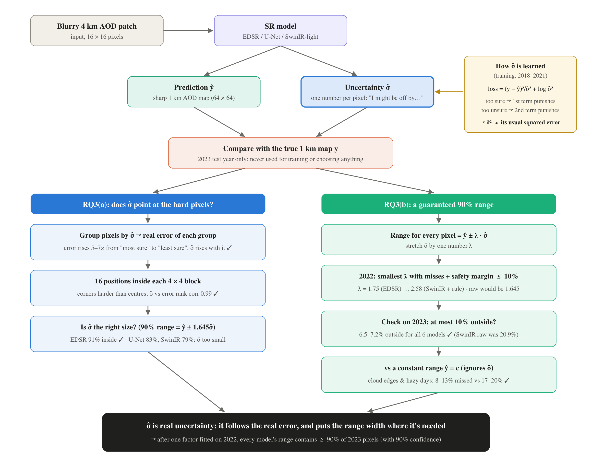
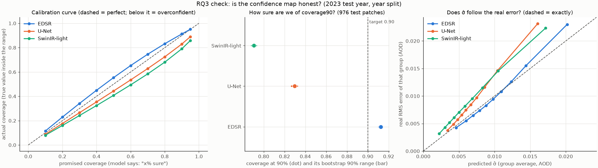
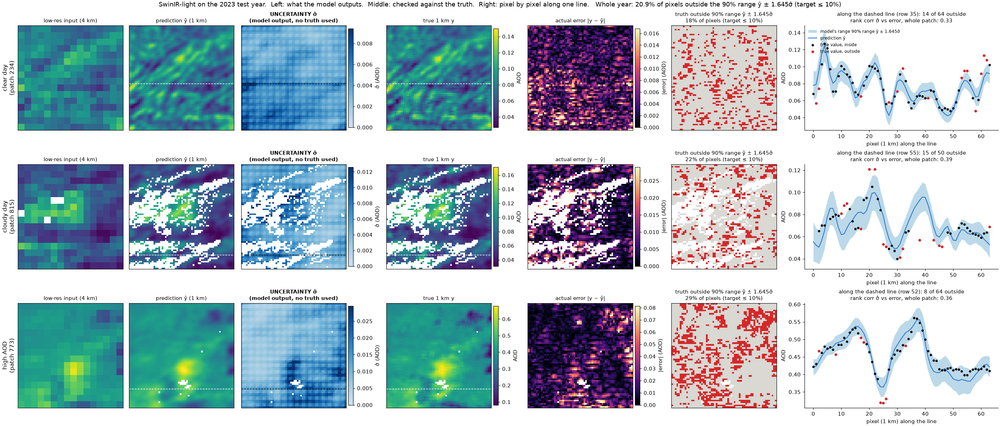
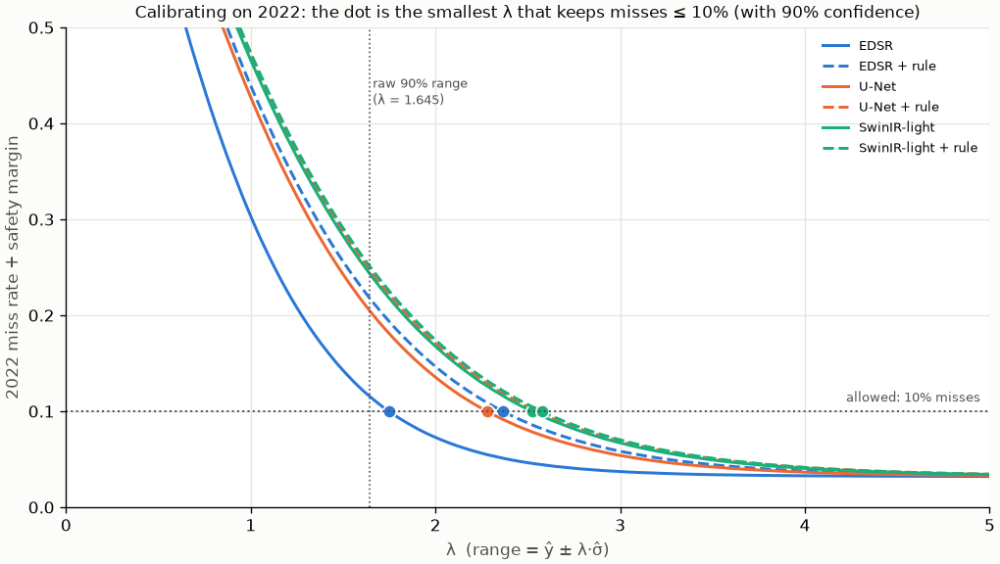
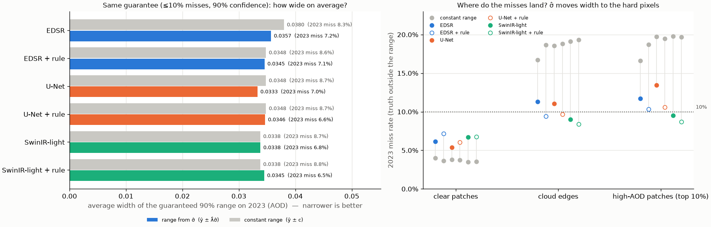
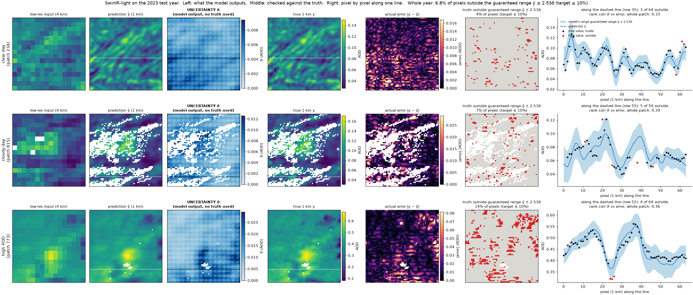
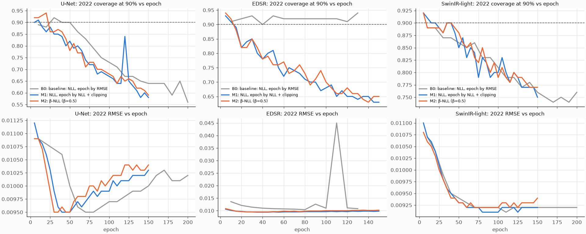
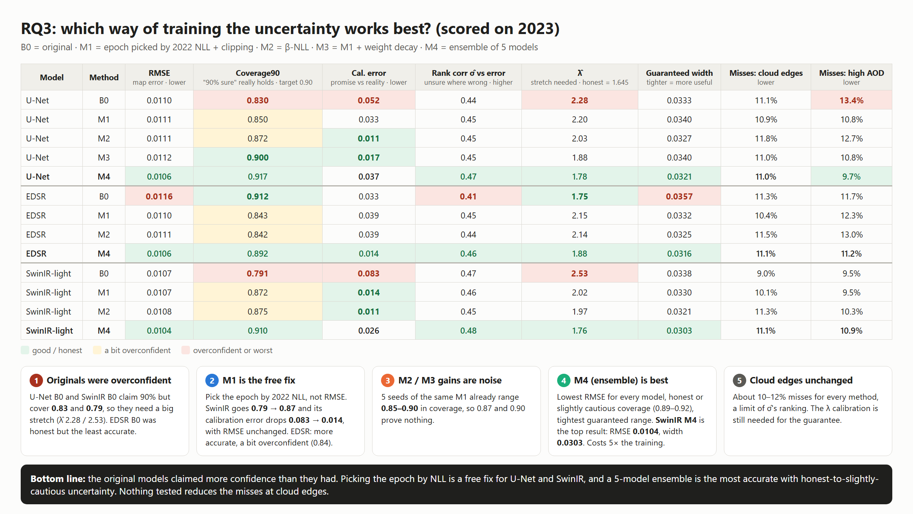
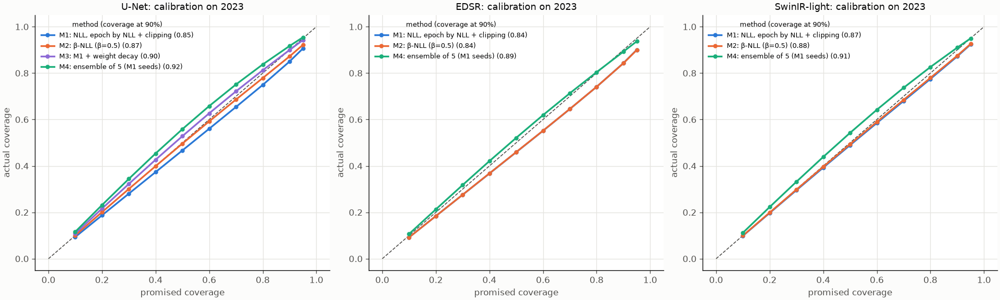
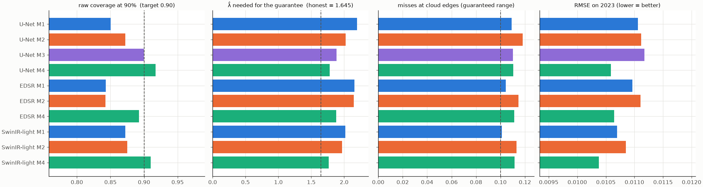

# RQ3 summary: how we measure uncertainty, and the results

Year split: train 2018–21, validation 2022 (pick the epoch, fit λ), test 2023 (scored once).
Full details: `rq3_uncertainty_results.md` and `rq3_methods_comparison.md`. Code: `src/rq3_*.py`.

---

## 1. Each model outputs two maps per pixel

- **ŷ**: the 1 km AOD.
- **σ̂**: how far off the model expects to be at that pixel.

Both are trained together with the Gaussian NLL loss (Kendall & Gal 2017), where ℓ = log σ̂²:

  L_NLL = (1/|M|) Σ_{i∈M} ½ ( e^(−ℓᵢ) (yᵢ − ŷᵢ)² + ℓᵢ ),   M = valid (non-cloud) pixels

This is exactly `uncertainty_loss` in `src/models/sr_net.py`.

| Equation | Code |
|---|---|
| ℓᵢ = log σ̂ᵢ² | `log_var` (second network output, clamped to [−10, 10]) |
| e^(−ℓᵢ) = 1/σ̂ᵢ² | `torch.exp(-log_var)` |
| (yᵢ − ŷᵢ)² | `(target - sharp) ** 2` |
| mean over valid pixels M | `(loss * mask).sum() / mask.sum()` |

- If the error is big but σ̂ is small, the first term blows up, so the model learns to raise σ̂ where it is usually wrong.
- If σ̂ is big everywhere, the second term grows, so it can't just say "unsure" everywhere.
- The best it can do is make **σ̂² equal to the expected squared error at that pixel**. σ̂ ends up big at cloud edges, on hazy days and at block corners.
- σ̂ is predicted **before** the truth is seen, so it is uncertainty, not the error itself.

## 2. We test σ̂ on 2023 only

2023 is never used for training or for choosing anything. Two checks:

- **Coverage:** does ŷ ± 1.645·σ̂ contain the true value 90% of the time?
- **Ranking:** are the pixels with high σ̂ really the ones with high error?

## 3. RQ3(a): does σ̂ point at the hard pixels? Yes (original models, B0)

- The real error rises **5–7×** from the most-confident pixels to the least-confident.
- Across the 16 positions of a 4×4 block, the rank correlation between σ̂ and the error is **0.99**. Block corners are harder than centres, and σ̂ learned that on its own.
- Per pixel, the rank correlation is 0.41–0.47.

The calibration curve (left) shows the problem fixed in section 5: plain EDSR is honest, but U-Net and SwinIR sit below the diagonal (overconfident).

Seeing it pixel by pixel (SwinIR-light). σ̂ is the model's own output; the true map and |error| are shown only for comparison:

## 4. RQ3(b): a guaranteed 90% range (original models, B0)

- The range is **ŷ ± λ·σ̂**, where λ is the smallest value that keeps misses ≤ 10% on 2022, plus a Hoeffding safety margin (conformal risk control; the PUQ and im2im-uq papers).
- λ is fitted on 2022 and checked once on 2023.

| Model (original runs, B0) | λ̂ (honest = 1.645) | Raw range: 2023 misses | Guaranteed range: 2023 misses |
|---|---|---|---|
| EDSR | 1.75 | 8.8% | **7.2%** |
| EDSR + rule | 2.37 | 18.8% | **7.1%** |
| U-Net | 2.28 | 17.1% | **7.0%** |
| U-Net + rule | 2.55 | 20.8% | **6.6%** |
| SwinIR-light | 2.53 | 20.9% | **6.8%** |
| SwinIR-light + rule | 2.58 | 21.3% | **6.5%** |

- On 2023, every model and every method (including M1–M4 below) misses **6.4–7.7%**, so the guarantee holds.

- A **constant-width** range with the same guarantee misses **17–20%** at cloud edges and on high-AOD days.
- The **σ̂ range** misses only **8–13%** there, because it is narrow on easy pixels and wider on hard ones. That is the evidence that σ̂ is real per-pixel uncertainty, not just the average error.

The same SwinIR patches with the calibrated range:

## 5. Overconfidence: found and fixed

- The original U-Net and SwinIR said "90% sure" but covered only **79–83%**.
- **Cause:** σ̂ keeps shrinking after accuracy on 2022 stops improving, and we picked the epoch by RMSE only.

Above: RMSE (bottom) flattens around epoch 30–75, but coverage (top) keeps falling. For example, U-Net goes from 0.90 to 0.56 by epoch 200. EDSR's original run also blew up around epoch 110; gradient clipping removed that.

### Fixes tested

| Method | What it is | Result |
|---|---|---|
| B0 | original: Gaussian NLL, epoch picked by 2022 RMSE | kept as the baseline |
| M1 | epoch picked by **2022 NLL** + gradient clipping | the cheap fix for U-Net and SwinIR: SwinIR 0.79 → 0.87 coverage. For EDSR, more accurate but a bit overconfident (0.91 → 0.84). |
| M2 | β-NLL (β = 0.5, Seitzer 2022) | no gain beyond seed noise |
| M3 | M1 + weight decay | no gain beyond seed noise |
| M4 | **ensemble of 5 seeds of M1**: σ² = mean σ̂² + spread of the 5 predictions | the best overall: lowest RMSE (0.0104–0.0106), honest or slightly cautious coverage (0.89–0.92), narrowest guaranteed range |

### Results on 2023

| Model | Method | RMSE ↓ | Coverage90 (target 0.90) | Cal. error ↓ | Rank corr σ̂ vs error ↑ | λ̂ (honest = 1.645) | Guaranteed width ↓ | Misses: cloud edges | Misses: high AOD |
|---|---|---|---|---|---|---|---|---|---|
| U-Net | B0 | 0.0110 | 0.830 | 0.052 | 0.44 | 2.28 | 0.0333 | 11.1% | 13.4% |
| U-Net | M1 | 0.0111 | 0.850 | 0.033 | 0.45 | 2.20 | 0.0340 | 10.9% | 10.8% |
| U-Net | M2 | 0.0111 | 0.872 | 0.011 | 0.45 | 2.03 | 0.0327 | 11.8% | 12.7% |
| U-Net | M3 | 0.0112 | 0.900 | 0.017 | 0.45 | 1.88 | 0.0340 | 11.0% | 10.8% |
| U-Net | **M4** | **0.0106** | 0.917 | 0.037 | **0.47** | **1.78** | **0.0321** | 11.0% | **9.7%** |
| EDSR | B0 | 0.0116 | 0.912 | 0.033 | 0.41 | 1.75 | 0.0357 | 11.3% | 11.7% |
| EDSR | M1 | 0.0110 | 0.843 | 0.039 | 0.45 | 2.15 | 0.0332 | 10.4% | 12.3% |
| EDSR | M2 | 0.0111 | 0.842 | 0.039 | 0.44 | 2.14 | 0.0325 | 11.5% | 13.0% |
| EDSR | **M4** | **0.0106** | **0.892** | **0.014** | **0.46** | 1.88 | **0.0316** | 11.1% | 11.2% |
| SwinIR-light | B0 | 0.0107 | 0.791 | 0.083 | 0.47 | 2.53 | 0.0338 | 9.0% | 9.5% |
| SwinIR-light | M1 | 0.0107 | 0.872 | 0.014 | 0.46 | 2.02 | 0.0330 | 10.1% | 9.5% |
| SwinIR-light | M2 | 0.0108 | 0.875 | 0.011 | 0.45 | 1.97 | 0.0321 | 11.3% | 10.3% |
| SwinIR-light | **M4** | **0.0104** | **0.910** | 0.026 | **0.48** | **1.76** | **0.0303** | 11.1% | 10.9% |

**Seed check.** For a single M1 run, coverage90 varies across 5 seeds: U-Net 0.85–0.90, EDSR 0.84–0.87, SwinIR 0.86–0.90. So the M2 and M3 differences are noise. The B0 → M1 improvement for U-Net and SwinIR, and the ensemble's gains, are larger than that noise. Accuracy barely moves between seeds: every SwinIR seed has RMSE 0.0107.

**Bottom line:**
- **M4 (ensemble)** is the best overall: lowest RMSE, honest or slightly cautious coverage (0.89–0.92), and the narrowest guaranteed range. It costs 5× the training. Its calibration error isn't always the lowest (U-Net M4 0.037 and SwinIR M4 0.026, because they are slightly cautious).
- **SwinIR M4 is the single best result:** RMSE 0.0104, coverage 0.910, λ̂ 1.76, guaranteed width 0.0303.
- **M1** is the free fix:
  - It fixes most of the overconfidence for U-Net and SwinIR.
  - It stopped the EDSR blow-up.
  - For EDSR it trades a little honesty (0.91 → 0.84) for better accuracy (0.0116 → 0.0110).
- No method reduces the misses at cloud edges (about 11% for all), so the λ calibration is still needed.

## 6. Is it correct? Yes, with these caveats (to state in the report)

- **Clean split:** 2023 is never used for training or for choosing anything.
- **What σ̂ misses:** a single model's σ̂ only captures data noise. It misses "the model has never seen this" uncertainty, which is why the ensemble is better.
- **The guarantee is approximate:** it assumes 2023 behaves like 2022, and patches from the same day are correlated.
- **What "truth" means here:** it is the 1 km MAIAC map, so σ̂ measures distance from MAIAC, not from real AOD or PM2.5.
- **Synthetic input:** the 4 km input is made by averaging; a real coarse satellite product may behave differently.
- **Training settings:** SwinIR seeds 1–4 were evaluated every 10 epochs; all other runs every 5.

## 7. What still needs doing

- [ ] **Fig. 4 / RQ1 in the .tex:** clarify the role of bicubic (Prof. Patiño's comment). It is an untrained baseline that sees only the 4 km input; the true map is used only to make the input, as the training target, and for scoring.
- [ ] **RQ3 section in the .tex:** it still describes the June 2023 data (32 patches) and the old results. It needs:
  - [ ] the year-split numbers;
  - [ ] the two-part RQ3 (a)+(b);
  - [ ] the λ guarantee (the methods section mentions "a single scalar recalibration factor", which is λ but without the guarantee);
  - [ ] B0 / M1 / M4.
- [ ] **Per-pixel figures:** if M4 becomes the main model, rerun the section 3–4 figures (5–7×, 0.99, pixel maps) on M4. They are currently from B0.
