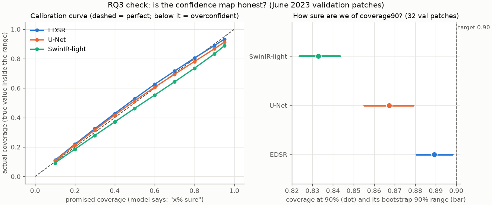

# RQ3: why the uncertainty is hard to quantify (response to feedback)

> **Update (year split):** the plan below has been carried out on the 2023 test year. RQ3 now has a two-part
> wording, (a) does σ̂ point at the hard pixels and (b) a guaranteed 90% range, calibrated on 2022.
> See [`rq3_uncertainty_results.md`](rq3_uncertainty_results.md). This note is kept as the June 2023 record.

**Feedback received:** *"I like the idea and where the report is going, but the uncertainty may be hard to quantify. Be careful with that."*

**Short answer:** we agree, and our first results back this up. On average the confidence map looks well calibrated, but that average hides three problems. The coverage number shifts with the model and with the training epoch while accuracy barely changes. The map is overconfident exactly where it matters most. And our validation data is too narrow to tell any of this apart reliably. We therefore plan to narrow RQ3 to a calibration check with clearly stated limits, rather than claim the confidence map measures "the uncertainty" of sharpened AOD.

All numbers below come from the temporary June 2023 split: 112 training patches from 13 days, and 32 validation patches from **June 28–30**. Reproduce with:
```
python -W ignore -m src.rq3_uncertainty_check
```

---

## What the confidence map is
Each model outputs a sharpened 1 km AOD map ŷ plus a per-pixel variance σ̂², trained with a Gaussian negative log-likelihood (Kendall & Gal, 2017). We check it with **coverage**: if the model says "90% sure", the true 1 km value should fall within ±1.645 σ̂ about 90% of the time.

---

## Evidence 1: on average, calibration looks fine



| Model | Coverage at 90% | Calibration error (10 levels) | Mean predicted σ | RMSE |
|---|---|---|---|---|
| EDSR | 0.889 | 0.019 | 0.0128 | 0.0142 |
| U-Net | 0.867 | 0.017 | 0.0123 | 0.0142 |
| SwinIR-light | 0.833 | 0.041 | 0.0112 | 0.0140 |

Taken alone, this would suggest RQ3 is mostly solved. The next three points show why it isn't.

## Evidence 2: the coverage number is unstable, while accuracy is stable
Within a **single training run**, coverage90 swings far more between epochs than RMSE does (epochs 100–300, scored every 25 epochs):

| Model | RMSE range | Coverage90 range |
|---|---|---|
| EDSR | 0.0140–0.0143 | **0.85–0.95** |
| U-Net | 0.0142–0.0150 | **0.87–0.97** |
| SwinIR-light | 0.0139–0.0142 | **0.83–0.91** |

The three models also end at different coverage (0.83–0.89) with practically the same RMSE (0.0140–0.0142). So **the calibration result depends on when training stops and which architecture is used**, not just on how good the model is. Any single coverage number we report could have come out as "well calibrated" or "clearly overconfident" depending on these choices.

## Evidence 3: overconfident where it matters

**Near cloud edges.** Coverage90 for pixels next to a missing (cloud) pixel, vs pixels away from gaps:

| Model | Near cloud edges (11,131 px) | Open sky |
|---|---|---|
| EDSR | 0.84 | 0.89 |
| U-Net | 0.82 | 0.87 |
| SwinIR-light | 0.81 | 0.84 |

Cloud edges are where the model has the least information. Those are the pixels where a user most needs an honest confidence value, and that's where it falls furthest short.

**Most-confident pixels.** We split pixels into thirds by predicted σ̂:

| Model | Most sure | Middle | Least sure |
|---|---|---|---|
| EDSR | 0.88 | 0.88 | 0.91 |
| U-Net | 0.84 | 0.86 | 0.91 |
| SwinIR-light | **0.77** | 0.83 | 0.90 |

The "least sure" pixels are well covered. The **pixels the model is most confident about are the most overconfident**: 77% actual vs 90% promised for SwinIR. The rank correlation between σ̂ and actual |error| is only **0.37–0.40**. The map points in the right direction, but only roughly.

## Evidence 4: the validation data can't tell these apart
- A bootstrap over the 32 validation patches gives narrow ranges, e.g. EDSR 0.881–0.898. But **all 32 patches come from 3 consecutive days** (June 28–30), and neighbouring patches overlap by half. The pixels are far from independent: effectively we have **3 weather situations**, not 116,926 pixels. The real uncertainty on coverage is much larger than the bootstrap suggests.
- None of those days is a smoke or dust event, the cases where public-health users would rely on the confidence map most.

## Evidence 5: what the confidence map does NOT measure
The model is trained to predict MAIAC's own 1 km AOD from its 4 km average. So σ̂ only describes **how hard it is to recover the 1 km MAIAC value from the 4 km one** (mean σ̂ ≈ 0.011–0.013, about the size of the RMSE). It does **not** include:
1. **The satellite retrieval's own error.** MAIAC 1 km AOD is itself an estimate, and its error vs ground truth (e.g. AERONET) never enters our training target.
2. **Model uncertainty under new conditions.** A single network's σ̂ captures noise it saw in training. It doesn't capture "I've never seen a day like this", e.g. smoke plumes or another season.
3. **Downstream uncertainty.** Nothing here says how uncertain a PM2.5 estimate would be.

Presenting σ̂ as "the uncertainty of the sharpened AOD" would therefore overstate what it is.

---

## What we plan to do (proposed scope for RQ3)
1. **Reword RQ3** to something like: *"Is the model's predicted per-pixel variance calibrated against held-out 1 km MAIAC AOD, and where does it fail?"* No claim about total or physical uncertainty.
2. **Report calibration, not just one number:** a calibration curve and coverage at several levels on the **2023 test year**, with uncertainty ranges computed **by day** rather than by patch.
3. **Report where it fails:** cloud edges, most-confident pixels and high-AOD days, as above.
4. **Fix the stopping-point problem:** choose the checkpoint on the 2022 validation year, then optionally rescale σ̂ with one factor fitted on 2022 (post-hoc calibration). Report test-year coverage before and after rescaling.
5. **Optional, if time allows:** a small deep ensemble (≈5 EDSRs with different seeds) to capture model uncertainty as well. Where the ensemble disagrees on smoke days would show point 2 of Evidence 5 directly.
6. **State the limits explicitly** in the report (Evidence 5).

## Questions for office hours
1. Is a calibration-focused RQ3 (points 1–4) an acceptable scope, or would you like the retrieval error included too (e.g. via AERONET)?
2. Is per-day bootstrapping on the 2023 test year an adequate way to report how uncertain the coverage estimate is?
3. Is post-hoc rescaling acceptable, as long as it's fitted on the validation year only?
4. Is the deep ensemble worth the extra compute, or should we keep RQ3 small and spend the time on data (2018–2023)?

---

**Caveat:** these results come from one month and three validation days, so they illustrate the problem rather than settle it. The final RQ3 numbers will use the 2018–21 / 2022 / 2023 split.

**Reference:** Kendall, A. & Gal, Y. (2017). *What Uncertainties Do We Need in Bayesian Deep Learning for Computer Vision?* NeurIPS.
