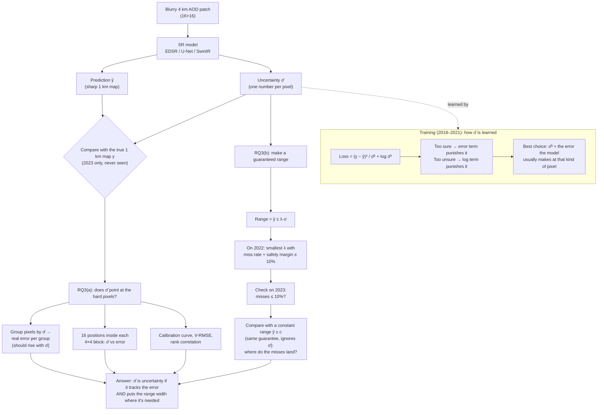

# RQ3: is the confidence map real uncertainty, and can we guarantee it?

## The question (new wording, replaces the old RQ3)
> **RQ3:** (a) Does the confidence map point at the pixels where the model is actually wrong?
> (b) Can we turn it into a range that is guaranteed to contain the true value for at least 90% of pixels
> in an unseen year, and is that range better than one that ignores the confidence map?

**Why the old RQ3 wasn't enough.** The old question was "when it says 80% sure, is it right 80% of the time?" A range that is the **same width everywhere** can pass that test without knowing anything about which pixels are hard. So passing it doesn't prove there is uncertainty in the map. (a) tests that σ̂ knows *which* pixels are hard, and (b) gives a definite, guaranteed answer.

Based on two papers (copies in `uncertainity_pdfs/`, see `papers/references.md`):
- **Zheng et al. 2026**: our loss makes σ̂² learn the **expected squared error at each pixel**, whatever the shape of the error distribution. Their checks: V-RMSE, calibration curve, sharpness, and per-sub-grid analysis. → RQ3(a)
- **Belhasin et al. (PUQ) / Angelopoulos et al. (im2im-uq)**: **conformal risk control**. Stretch the range by one factor λ, chosen on calibration data, so that the miss rate is ≤ α with a statistical guarantee. → RQ3(b)

All numbers are on the **2023 test year**, which is never used for training or for choosing anything.

---

## How the uncertainty is measured (flow chart)


(Editable source: `diagrams/rq3_flowchart.svg`. The PNG is for slides.)

<details>
<summary>Same flow chart as Mermaid text (renders on GitHub)</summary>


</details>

In words:
1. The model makes **two maps** from the blurry input alone: the prediction ŷ and the uncertainty σ̂. It never sees the true 1 km map at this point.
2. σ̂ was learned in training through the loss, which forces it toward the size of the error the model usually makes at that kind of pixel.
3. **RQ3(a)** compares σ̂ with the real error on 2023, pixel by pixel.
4. **RQ3(b)** stretches σ̂ by one factor λ, chosen on 2022, and checks on 2023 that the guarantee holds.

---

## RQ3(a): does σ̂ point at the pixels where the model is wrong?
```
python -W ignore -m src.rq3_uncertainty_check --data years
```


### 1. Group the pixels by σ̂, then look at their real error
All 3.66 million real 2023 pixels, split into 10 equal groups from "most sure" to "least sure":

| σ̂ group | EDSR σ̂ → real RMS error | U-Net σ̂ → real error | SwinIR σ̂ → real error |
|---|---|---|---|
| most sure 10% | 0.0046 → 0.0043 | 0.0034 → 0.0038 | 0.0022 → 0.0032 |
| middle (5th) | 0.0088 → 0.0083 | 0.0060 → 0.0074 | 0.0050 → 0.0071 |
| least sure 10% | 0.0202 → 0.0230 | 0.0161 → 0.0232 | 0.0172 → 0.0223 |

- **The real error rises about 5–7× from the "most sure" to the "least sure" group, and σ̂ rises with it** for all three models (right panel). σ̂ knows which pixels are hard.
- **EDSR's σ̂ is about the right size** (on the diagonal). U-Net and SwinIR are ranked correctly but **too small by about 20–30%** (above the diagonal). That's a scale problem, which part (b) fixes.

### 2. The 16 positions inside each 4×4 block
Each low-res pixel covers a 4×4 block of 1 km pixels. Average error and average σ̂ for each of the 16 positions (EDSR):

| | RMS error | mean σ̂ |
|---|---|---|
| block corners | 0.0132–0.0139 | 0.0116–0.0121 |
| block centre (4 pixels) | 0.0081–0.0089 | 0.0077–0.0080 |

Rank correlation between σ̂ and error across the 16 positions: **0.99 for all three models.** Pixels near the centre of a block are easier to recover; pixels at the corners sit between neighbouring low-res values and are harder. σ̂ learned this on its own. That's the faint grid in the σ̂ maps, and it's real, not an artifact (Zheng et al. found the same thing with a 2×2 grid).

### 3. Summary numbers
| Model | Coverage at 90% | Calibration error | V-RMSE ↓ | Mean 90% width | Rank corr σ̂ vs \|error\| | Cloud edges / open sky coverage |
|---|---|---|---|---|---|---|
| EDSR | **0.91** | **0.033** | 3.98e-4 | 0.0335 | 0.41 | 0.87 / 0.92 |
| U-Net | 0.83 | 0.052 | 3.95e-4 | 0.0240 | 0.44 | 0.77 / 0.83 |
| SwinIR-light | 0.79 | 0.083 | **3.74e-4** | **0.0220** | **0.47** | 0.77 / 0.79 |

- Per pixel the rank correlation is only 0.41–0.47, because a single pixel's error is very noisy. Averaged over groups (tables above) the link is very strong.
- SwinIR has the **best-ranked** σ̂ (highest correlation, lowest V-RMSE) but the **worst-scaled** (79% coverage). EDSR is the reverse.

**Answer to (a): yes.** σ̂ points at the pixels where the model is wrong: by σ̂ group, by position in the block, and at cloud edges and plumes (images below). It's informative, but on two of the three models it's too small.

---

## RQ3(b): a range with a guarantee
```
python -W ignore -m src.rq3_guaranteed_range
```

### How it works
1. Range for every pixel: **ŷ ± λ·σ̂**. (The raw "90% range" is λ = 1.645.)
2. On **2022** (1,142 patches): for each λ, the miss rate = fraction of real pixels outside the range, averaged over patches.
3. Add a **safety margin** for only having 1,142 calibration patches (Hoeffding: √(ln(1/δ)/2n) = 0.032).
4. Pick the **smallest λ with miss rate + margin ≤ 10%**. Then, with 90% confidence (δ = 0.10), the miss rate on new data is ≤ 10%.
5. Check on **2023**.
6. Do the same for a **constant range ŷ ± c** that ignores σ̂, as the baseline.


### Results (2023)
| Model | λ̂ (raw = 1.645) | Raw 90% range: 2023 misses | **Guaranteed range: 2023 misses** | Mean width (AOD) | Constant range: misses / width |
|---|---|---|---|---|---|
| EDSR | 1.75 | 8.8% | **7.2%** ✅ | 0.0357 | 8.3% / 0.0380 |
| EDSR + rule | 2.37 | 18.8% | **7.1%** ✅ | 0.0345 | 8.6% / 0.0348 |
| U-Net | 2.28 | 17.1% | **7.0%** ✅ | 0.0333 | 8.7% / 0.0348 |
| U-Net + rule | 2.55 | 20.8% | **6.6%** ✅ | 0.0346 | 8.7% / 0.0348 |
| SwinIR-light | 2.53 | 20.9% | **6.8%** ✅ | 0.0338 | 8.7% / 0.0338 |
| SwinIR-light + rule | 2.58 | 21.3% | **6.5%** ✅ | 0.0345 | 8.8% / 0.0338 |

- **The guarantee holds for every model on 2023 (6.5–7.2% misses, limit 10%).** Models that were overconfident (up to 21% misses) are fixed by one number λ̂.
- λ̂ tells you how overconfident each raw σ̂ was: EDSR needs only 6% wider (1.75 vs 1.645); SwinIR needs 54% wider.
- **Average width is about the same as the constant range** (0.033–0.036 AOD, about ±0.017). So σ̂ does **not** make the range narrower on average. Its value is in where the width goes:


### Where the misses land (2023)
| | σ̂ range: misses | constant range: misses |
|---|---|---|
| clear patches | 5.4–7.2% | 3.5–4.0% |
| **cloud edges** | **8.4–11.3%** | **16.7–19.3%** |
| **high-AOD patches (top 10%)** | **8.7–13.4%** | **16.6–19.8%** |

- The constant range meets the 10% target **by over-covering easy clear pixels and failing on the hard ones**: about 1 in 5 pixels missed at cloud edges and on hazy days, exactly where a health user would need it.
- The σ̂ range is **narrow on easy pixels and up to 2× wider on hard ones** (e.g. SwinIR: 0.024 on clear patches, 0.051 at cloud edges). The misses end up spread much more evenly. SwinIR with the rule stays under 10% in every group.

**Answer to (b): yes, with a guarantee.** After one calibration factor, every model's range contains ≥ 90% of 2023 pixels. The range built from σ̂ isn't narrower on average than a constant one, but it's **far more reliable where it matters** (cloud edges, hazy days). That's the practical evidence that σ̂ carries real uncertainty.

---

## Images: raw range vs guaranteed range
```
python -W ignore -m src.rq3_uncertainty_maps --model swinir                # raw 90% range (1.645 σ̂)
python -W ignore -m src.rq3_uncertainty_maps --model swinir --calibrated   # guaranteed range (λ̂ σ̂)
```
**Raw 90% range (ŷ ± 1.645σ̂): 20.9% outside**


**Guaranteed range (ŷ ± 2.53σ̂): 6.8% outside**


Same σ̂ map; only the band in the line plot gets wider. With the guaranteed range the red dots mostly disappear, except on the hazy patch (14% outside in that one patch). The guarantee is on the average over all patches, not on every single patch.

---

## Limits (say these in the report)
- **The guarantee is an average over patches**, not per patch or per pixel. One hazy patch can still miss 14%.
- **It assumes 2022 and 2023 behave alike.** Patches from the same day are correlated, so the real number of independent samples is smaller than 1,142, and the safety margin is a bit optimistic. Fixing this needs a `date` in each patch file, so calibration can be done by day (ask Rency).
- **σ̂ is uncertainty about MAIAC's own 1 km value.** It doesn't include MAIAC's retrieval error versus the ground, or uncertainty about PM2.5.
- One training run (one seed) per model.

## Files
| File | What it does |
|---|---|
| `src/rq3_uncertainty_check.py --data years` | RQ3(a): calibration curve, error vs σ̂ groups, 4×4 positions, V-RMSE, sharpness |
| `src/rq3_guaranteed_range.py` | RQ3(b): calibrate λ on 2022, check on 2023, constant-range baseline; saves `runs/rq3b_lambda.json` |
| `src/rq3_uncertainty_maps.py [--calibrated]` | The per-patch images and line plots |
| `src/metrics.py` | `v_rmse`, `sharpness` (new), `coverage`, `calibration_error` |
