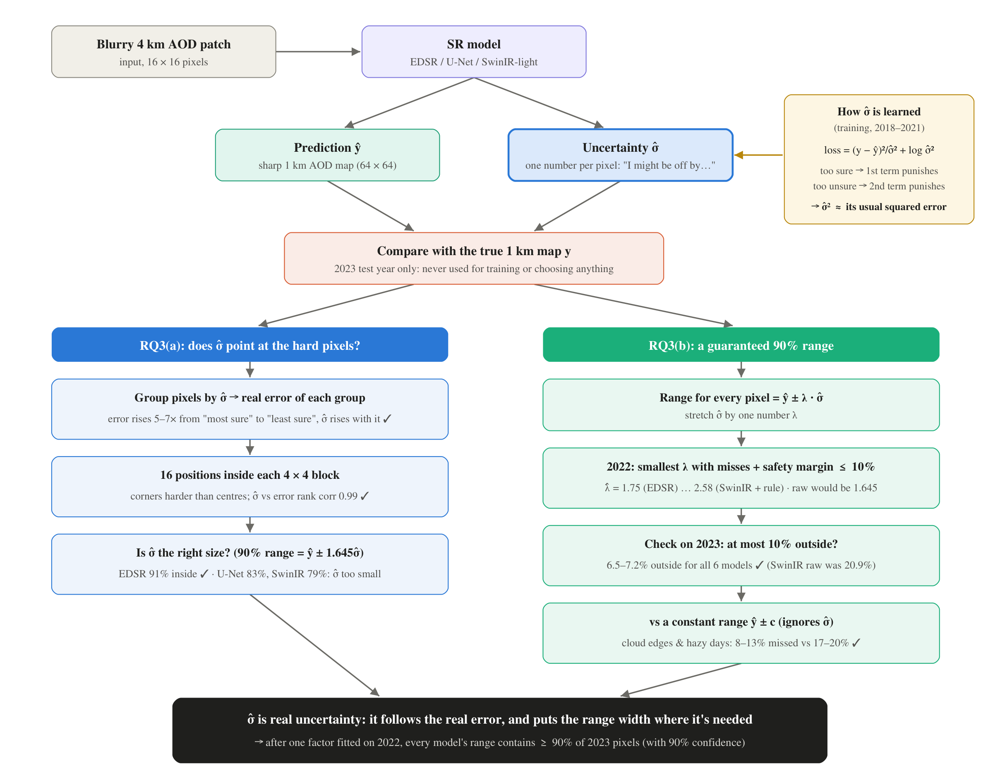
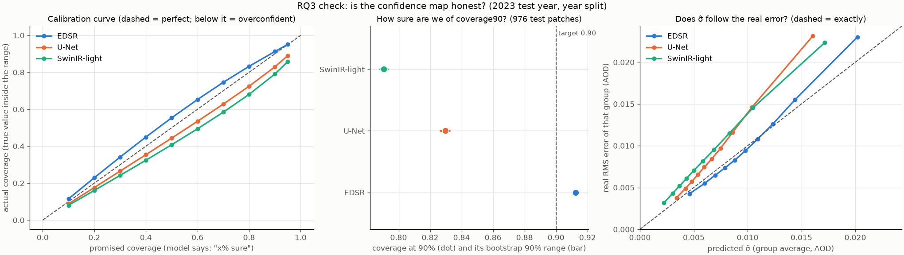
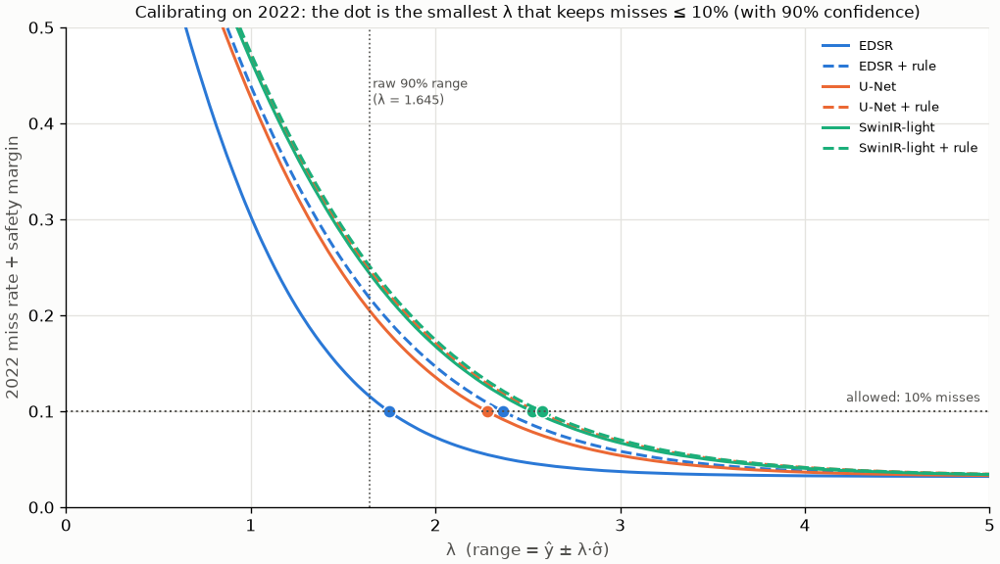
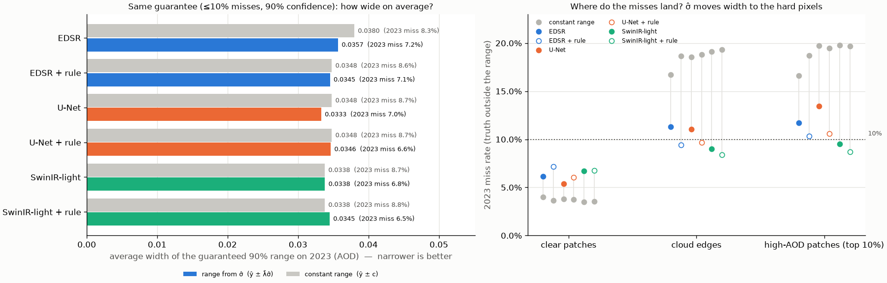
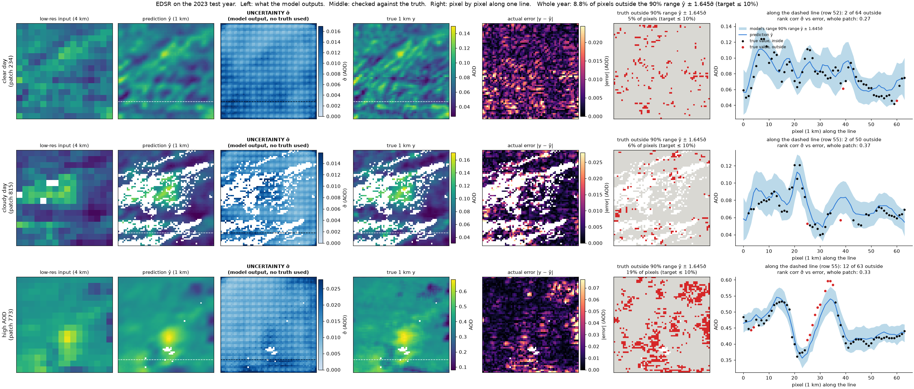
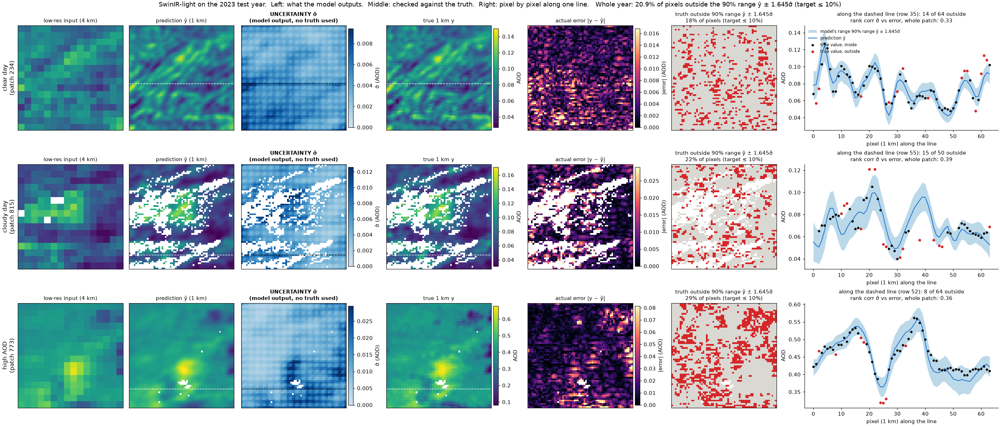
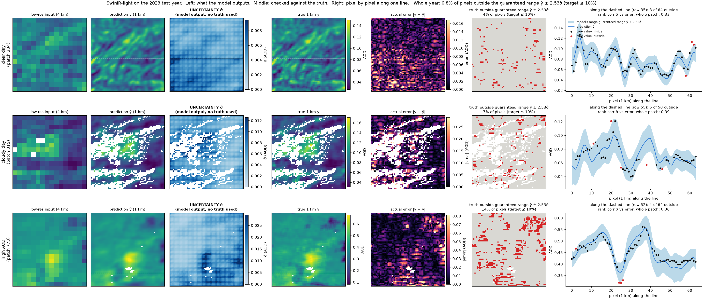
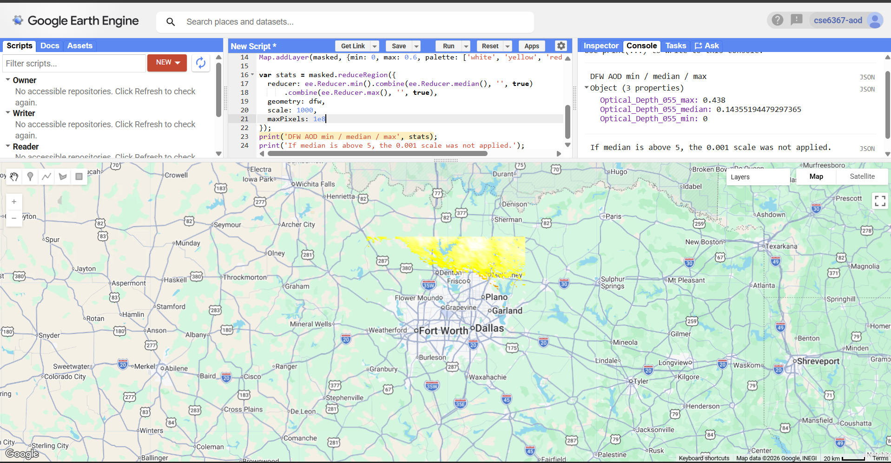
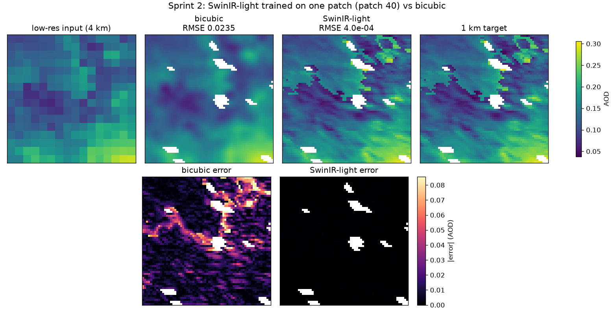
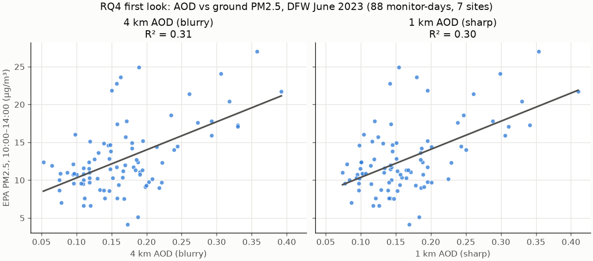

# Year-split results: RQ1, RQ2 and RQ3

## What this is in one sentence
We train all three SR models on Rency's real split by year (**2018–21 train / 2022 val / 2023 test**), with and without the average-back rule, and score them **once** on 2023, a year they never saw.

These numbers replace the preliminary June 2023 numbers in `sprint3_rq1_README.md`. Those only checked that the code works.

### Summary
| RQ | Answer on 2023 |
|---|---|
| **RQ1** (beat bicubic?) | **Yes.** All 6 models, 8–15% lower RMSE. Best: SwinIR-light, RMSE 0.0107 vs 0.0126, +1.4 dB PSNR. |
| **RQ2** (average-back rule) | **Works at no cost.** The output re-averages to the input almost exactly (8.7e-09), with the same or better accuracy and detail. |
| **RQ3(a)** (does σ̂ point at the hard pixels?) | **Yes.** Real error rises 5–7× from the most- to the least-confident pixels, and σ̂ rises with it. |
| **RQ3(b)** (guaranteed 90% range?) | **Yes.** After one factor fitted on 2022, every model's range contains ≥ 90% of 2023 pixels (6.5–7.2% outside). |
| **RQ4** (EPA PM2.5) | Not yet on the year split: needs Rency's daily maps with coordinates. |

---

## How we updated the research questions
RQ1, RQ2 and RQ4 are unchanged. **RQ3 was rewritten** after the first year-split results and the instructor's feedback ("the uncertainty may be hard to quantify").

| | Old (proposal) | New |
|---|---|---|
| **RQ3** | Is the confidence map reliable? When it reports 80% sure, is it correct about 80% of the time? | **(a)** Does the confidence map point at the pixels where the model is actually wrong? **(b)** Can we turn it into a range that is guaranteed to contain the true value for at least 90% of pixels in an unseen year, and is that range better than one that ignores the confidence map? |
| How it's tested | Coverage at one level (e.g. 90%) | (a) Error vs σ̂ groups, 4×4 block positions, calibration curve, V-RMSE. (b) Conformal calibration on 2022, check on 2023, compared with a constant-width range |

**Why we changed it:**
1. **The old test can't tell uncertainty apart from an average.** A range of the **same width everywhere** can hit 90% coverage without knowing anything about which pixels are hard. Passing the old RQ3 therefore didn't show that σ̂ is real uncertainty. Part (a) tests exactly that.
2. **The old test had no clear "done".** Raw coverage moved between 0.79 and 0.97 depending on the model and the epoch. Part (b) gives a yes/no answer with a statistical guarantee.
3. **Both parts come from published methods** (papers in `uncertainity_pdfs/`):
   - Zheng et al. 2026, *Self-Supervised Uncertainty Estimation for Super-Resolution of Satellite Images*: our loss makes σ̂² estimate the expected squared error at each pixel. Their checks (V-RMSE, coverage, sharpness, sub-grid analysis) are what part (a) uses.
   - Belhasin et al., *PUQ* (TPAMI 2024), and Angelopoulos et al., *im2im-uq* (ICML 2022): conformal risk control, i.e. calibrate the range so that misses are ≤ α with probability ≥ 1 − δ. That's part (b).
4. We kept **four RQs** (RQ3 has two parts) rather than adding an RQ5, so the proposal's structure stays the same.

The full RQ3 write-up is in `rq3_uncertainty_results.md`, and in the second part of this PDF.

---

## How to run it
```
python -W ignore -m src.train --data years --model edsr   --epochs 200 --eval_every 10
python -W ignore -m src.train --data years --model unet   --epochs 200 --eval_every 10
python -W ignore -m src.train --data years --model swinir --epochs 200 --eval_every 10
```
Add `--consistency` to each for the average-back rule. That's 6 runs in total.

- Every `--eval_every` epochs it scores **2022 val**, and it remembers the epoch with the lowest val RMSE.
- At the end it goes back to that epoch and scores **2023 test once** (the `TEST 2023` line).
- 2023 is never used to choose anything, so the test score is fair.
- Models are saved to `checkpoints/<model>[_consistency]_years.pt`.

### How long it takes (RTX 3080)
| Model | 200 epochs |
|---|---|
| EDSR | ~8 min |
| U-Net | ~7 min |
| SwinIR-light | ~50 min |

---

## The data (from Rency, `data/split_data/`)
| Set | Years | Patches | What it's for |
|---|---|---|---|
| Train | 2018–2021 | 4,543 | The model learns from these |
| Val | 2022 | 1,142 | Picks the best epoch |
| Test | 2023 | 976 | Scored once, at the end |

- Same format as the Sprint 2 file: `lr` 16×16, `hr` 64×64, `mask`, `scale = 4`. Values are already real AOD.
- Normalization uses Rency's **training-only** mean and std (`train_stats.npz`: 0.1035, 0.0958).
- Different years never share pixels, so no overlap check is needed (unlike the June split).
- Loaded by `make_year_datasets()` in `src/dataset.py`.

---

## Results (2023 test year, 200 epochs, best epoch picked on 2022)

| | Parameters | RMSE ↓ | vs bicubic | PSNR ↑ | SSIM ↑ | Detail (1.0 = right) | Consistency ↓ | Coverage90 (target 0.90) | Cal. error ↓ | Mean σ̂ | Best epoch |
|---|---|---|---|---|---|---|---|---|---|---|---|
| Bicubic | – | 0.0126 | – | 37.97 | 0.927 | 0.49 | – | – | – | – | – |
| EDSR | 1.52M | 0.0116 | −8% | 38.71 | 0.940 | 0.64 | 1.5e-03 | **0.91** | **0.033** | 0.0102 | 80 |
| EDSR + rule | 1.52M | 0.0109 | −13% | 39.24 | 0.948 | 0.71 | 8.7e-09 | 0.81 | 0.066 | 0.0073 | 140 |
| U-Net | 1.93M | 0.0110 | −13% | 39.14 | 0.948 | 0.72 | 1.7e-03 | 0.83 | 0.052 | 0.0073 | 70 |
| U-Net + rule | 1.93M | 0.0110 | −13% | 39.21 | 0.949 | 0.73 | 8.7e-09 | 0.79 | 0.081 | 0.0068 | 40 |
| **SwinIR-light** | 0.92M | **0.0107** | **−15%** | **39.42** | **0.951** | 0.74 | 6.4e-04 | 0.79 | 0.083 | 0.0067 | 110 |
| **SwinIR-light + rule** | 0.92M | **0.0107** | **−15%** | 39.40 | **0.951** | **0.75** | 8.7e-09 | 0.79 | 0.086 | 0.0067 | 110 |

"Rule" = the average-back rule (`--consistency`). Full logs are in `runs/years_<model>.log`.

### RQ1: can deep SR beat simple interpolation?
**Yes.** All six models beat bicubic on 2023 on every score: 8–15% lower RMSE, +0.7 to +1.4 dB PSNR, +0.013 to +0.024 SSIM.
- **SwinIR-light is the best**, with the fewest parameters.
- The models add real detail. Detail goes from 0.49 (bicubic) to 0.64–0.75 while the error drops, so the new detail is real, not made up. They're still smoother than the real map (1.0).
- Every best epoch is well before 200 (40–140), so 200 epochs is enough.
- The gain is about 3× larger than on the June split (−15% vs −5%). That's because there's about 40× more training data.

### RQ2: does the average-back rule reduce made-up detail without smoothing the map?
**It keeps the output faithful to the input at no cost.**
- Consistency error drops from 6e-04–2e-03 to **8.7e-09**: the sharp map now averages back to the blurry input almost exactly. (The rule is a hard correction applied after the network, so this is by construction.)
- Accuracy is equal or better: EDSR improves (−8% → −13%), and U-Net and SwinIR stay the same.
- Detail goes up slightly, not down (e.g. EDSR 0.64 → 0.71). So the rule does **not** smooth the map back toward bicubic.

### RQ3: is the confidence map real uncertainty?
**First look (raw σ̂, the old RQ3 test): only plain EDSR is honest.** The more accurate models are **overconfident**: when they say "90% sure", the true value is inside the range only 79–83% of the time. The sections below explain what that means.

**With the new two-part RQ3** (full details in `rq3_uncertainty_results.md`):



**(a) Does σ̂ point at the hard pixels? Yes.**



- Left: calibration curve. EDSR sits on the diagonal; U-Net and SwinIR fall below it (overconfident).
- Right: pixels grouped by σ̂. The real error rises 5–7× from the most- to the least-confident group, and σ̂ rises with it. EDSR is on the diagonal (the right size); U-Net and SwinIR are correctly ranked but 20–30% too small.
- Across the 16 positions inside each 4×4 block, σ̂ and the error have a rank correlation of 0.99: block corners are harder than block centres, and σ̂ learned that on its own.

**(b) A guaranteed 90% range? Yes, for every model.** Range = ŷ ± λ·σ̂, with λ fitted on 2022.



| Model | λ̂ (raw = 1.645) | Raw range: 2023 misses | Guaranteed range: 2023 misses |
|---|---|---|---|
| EDSR | 1.75 | 8.8% | **7.2%** |
| EDSR + rule | 2.37 | 18.8% | **7.1%** |
| U-Net | 2.28 | 17.1% | **7.0%** |
| U-Net + rule | 2.55 | 20.8% | **6.6%** |
| SwinIR-light | 2.53 | 20.9% | **6.8%** |
| SwinIR-light + rule | 2.58 | 21.3% | **6.5%** |



- Left: on average, the σ̂ range is about as wide as a constant-width range with the same guarantee.
- Right: the difference is **where the misses land**. The constant range misses **17–20%** of pixels at cloud edges and on hazy days. The σ̂ range keeps those at **8–13%**, because it's narrow on easy pixels and wider on hard ones. That's the evidence that σ̂ is real uncertainty, not an average error.

### Caveat
Each model was trained **once, with one seed**. Small gaps (U-Net vs SwinIR, rule vs no rule for SwinIR) could be run-to-run noise. The gap to bicubic is consistent across all six runs, so that part is solid.

---

## How the confidence map works

### 1. The model outputs two maps, not one
For each 64×64 patch, the network outputs two channels:

| Output | What it is |
|---|---|
| **ŷ** (`sharp`) | the sharpened 1 km AOD: bicubic + the detail the network adds |
| **log σ̂²** (`log_var`) | how **unsure** the model is at each pixel |

In code (`src/models/sr_net.py`), the last layer of EDSR, U-Net or SwinIR is split into two heads: one for the detail, one for the uncertainty. The model predicts the **log** of the variance, not the variance itself, because:
- a variance can't be negative, but a log can be any number, so no special handling is needed;
- it's clamped to [−10, 10] so `exp()` can't blow up.

To get the uncertainty in AOD units: σ̂ = exp(0.5 · log_var) × std, where std is the training normalization (0.0958).

### 2. How it learns to be unsure: the loss
There is **no "true uncertainty" map to copy**. Nobody tells the model how unsure it should be. It learns this from the loss (`uncertainty_loss`, a Gaussian negative log-likelihood, Kendall & Gal 2017):

```
loss per pixel = 0.5 × [ (y − ŷ)² / σ̂²   +   log σ̂² ]
                         error term          cost of saying "unsure"
```

- **Error term:** being wrong is divided by σ̂². If the model says "I'm unsure here" (big σ̂), mistakes at that pixel cost less.
- **Cost term:** saying "unsure" isn't free. A big σ̂ makes `log σ̂²` bigger.
- The best the model can do at each pixel is set **σ̂² ≈ the squared error it usually makes there**:
  - say "unsure" too much → the cost term punishes it;
  - say "sure" too much → the error term punishes it.
- So σ̂ learns to be big where the model tends to be wrong (cloud edges, sharp plumes) and small where it's easy (flat, clear areas).
- Cloud pixels are masked out, like in every other loss.

This is also why the training loss can go **negative**: `log σ̂²` is negative when σ̂ is small.

### Is σ̂ uncertainty, or just the loss?
The key difference: **the loss needs the true answer, and σ̂ doesn't.**

| | Loss / error | Uncertainty σ̂ |
|---|---|---|
| Needs the true 1 km map? | **Yes**: (y − ŷ)² can't be computed without y | **No**: the network outputs it from the blurry input alone |
| When does it exist? | After you know the answer | Before; it's a **prediction** |
| What is it? | How wrong the model *was* | How wrong the model *expects to be* at this pixel |
| Used when deployed? | No, there's no truth for real 4 km data | Yes |

- **Analogy:** a forecast of "70% chance of rain" is made without knowing tomorrow's weather. Checking whether it rained is the scoring. σ̂ is the forecast; the error maps and red pixels in the figures are only the scoring.
- The loss is used in **training** to teach σ̂ which kinds of pixels tend to be wrong. On 2023 the model writes down σ̂ first; the truth is used only afterwards, to check it.
- **Evidence it's a prediction, not an average loss:** σ̂ varies about 10× within 2023 (0.002 to 0.02 AOD). It ranks the error before seeing it (5–7× more error in the "least sure" group). It learned structure nobody told it about (block corners, cloud edges, plumes). And a constant-width range, which is what "the average loss" would give, fails at cloud edges and on hazy days, where the σ̂ range doesn't.
- **What kind of uncertainty:** aleatoric (how much the true 1 km value can vary given this blurry input), as defined by Kendall & Gal 2017 and Zheng et al. 2026. It doesn't cover "a day unlike anything in training" (that needs an ensemble) or MAIAC's own error.

### 3. How we check it: coverage
If σ̂ is honest and errors are roughly bell-shaped (Gaussian), then:

| The model says | The range is | The true value should fall inside |
|---|---|---|
| "90% sure" | ŷ ± 1.645 σ̂ | 90% of the time |
| "80% sure" | ŷ ± 1.282 σ̂ | 80% of the time |
| "50% sure" | ŷ ± 0.674 σ̂ | 50% of the time |

We count how often that actually happens on 2023 (`src/metrics.py`):

| Number | Meaning | Good is |
|---|---|---|
| **coverage90** | fraction of real pixels where \|y − ŷ\| ≤ 1.645 σ̂ | 0.90 |
| **cal_err** | the same check at 10 levels (10%…95%), averaging how far off each one is | 0 |
| **mean σ̂** (`unc`) | the average uncertainty the model reports | small, **as long as** coverage is right |

- Coverage **below** the target = **overconfident** (ranges too narrow).
- Coverage **above** the target = **underconfident** (ranges too wide).
- Mean σ̂ is there because a model could get perfect coverage by saying "very unsure" everywhere. That would be useless.

### 4. What the results say
A quick rule of thumb: an honest σ̂ should be about the same size as the model's typical error (RMSE).

| Model | RMSE | Mean σ̂ | σ̂ / RMSE | Coverage90 |
|---|---|---|---|---|
| EDSR | 0.0116 | 0.0102 | 0.88 | 0.91 ✅ |
| U-Net | 0.0110 | 0.0073 | 0.66 | 0.83 |
| SwinIR | 0.0107 | 0.0067 | 0.63 | 0.79 |

- **EDSR's σ̂ is about the size of its error**, so its ranges are about right.
- **U-Net and SwinIR shrink σ̂ much more than they shrink their error.** Their ranges are about a third too narrow, so they're overconfident.
- **The average-back rule makes this worse**, e.g. EDSR 0.91 → 0.81. The rule shifts ŷ after the network, but σ̂ isn't adjusted for that shift. Also, the more accurate a model gets on training years, the more confident it becomes, and 2023 is a little harder than the training years.
- The ordering (calibrated but less accurate vs accurate but overconfident) is a useful finding for the report: **the best-scoring model is not the most trustworthy one.**

### 5. Seeing it pixel by pixel (images)
```
python -W ignore -m src.rq3_uncertainty_maps --model edsr     # -> docs/diagrams/rq3_maps_edsr.png
python -W ignore -m src.rq3_uncertainty_maps --model swinir   # -> docs/diagrams/rq3_maps_swinir.png
```
Add `--consistency` for the models trained with the rule, or `--patches 12 340` to pick your own 2023 patches.

Each row is one 2023 test patch, read left to right in three parts:

| Part | Panels | What it shows |
|---|---|---|
| **1. What the model outputs** | low-res input · prediction ŷ · **uncertainty σ̂** (blue) | The two maps the model makes from the blurry input alone. **No truth is used.** Dark blue = "I'm unsure here". |
| **2. Checked against the truth** | true 1 km · actual error · truth outside the 90% range (red) | Where the model was really wrong, and the pixels where the true value fell outside ŷ ± 1.645σ̂. Honest ≈ 10% red. |
| **3. Pixel by pixel along one line** | line plot | One row of the patch (the dashed line). Blue line = prediction, blue band = the model's 90% range **for each pixel**, dots = true values (red = outside the band). |

The line plot is the clearest demonstration: **every pixel gets its own error bar**, and the band is wider where the model is less sure.

**EDSR, raw 90% range (ŷ ± 1.645σ̂):**



**SwinIR-light, raw 90% range (ŷ ± 1.645σ̂):**



**SwinIR-light, guaranteed range (ŷ ± 2.53σ̂, calibrated on 2022):** same σ̂ map; only the band is wider. Whole year: 20.9% → 6.8% outside.



| Patch | EDSR outside 90% range | SwinIR outside 90% range |
|---|---|---|
| Clear day (234) | 5% | 18% |
| Cloudy day (815) | 6% | 22% |
| High AOD (773) | **19%** | **29%** |
| **Whole 2023 year** | **8.8%** ✅ | **20.9%** |

What the pictures show:
- **σ̂ does point at the hard pixels.** On the cloudy day, σ̂ is darkest along cloud edges, which is also where the error is biggest. On the hazy day it's darkest around the plume, and in the line plot the band widens over the AOD peak.
- **But not wide enough on the hazy day:** in the EDSR line plot, the true peak (≈ 0.60) sits above the whole band (≈ 0.54), a run of red dots in a row. The model knew the peak was uncertain, but underestimated by how much.
- **σ̂ is always high along the patch border**, where the model has no neighbours on one side. The line plot skips the 8 border rows for that reason.
- **EDSR is honest on normal days:** red pixels are few and scattered.
- **SwinIR's red pixels are spread everywhere**, so its ranges are too narrow **across the board**. That's the kind of error one rescale factor (fitted on 2022) can fix.
- **Both are overconfident on the high-AOD patch**, and the red pixels **cluster** where the error is biggest (top right). That can't be fixed with one factor. It's the "never seen a day like this" uncertainty from point 6 below.
- σ̂ shows a faint **4-pixel grid**, matching the 4×4 blocks of the low-res input: the model is less sure about pixels far from block centres.
- The rank correlation between σ̂ and |error| within a patch is only **0.27–0.39**. The map points the right way, but roughly.

### 6. What the confidence map does NOT measure
σ̂ only says **how hard it is to recover MAIAC's 1 km value from its 4 km average**. It does not include:
1. MAIAC's own retrieval error (MAIAC 1 km AOD is itself an estimate);
2. "I've never seen a day like this" uncertainty, e.g. a smoke plume in a new season. One network can't capture that; an ensemble can;
3. any uncertainty about PM2.5.

More detail and the earlier June checks are in `rq3_uncertainty_note.md`.

---

## What's next
- [x] **RQ3 fix:** a guaranteed range, calibrated on 2022 (`rq3_uncertainty_results.md`, part b). Every model ≤ 7.2% misses on 2023.
- [x] **RQ3 figures on 2023:** calibration curve, error vs σ̂, 4×4 positions, and the per-patch images (`rq3_uncertainty_results.md`, part a).
- [ ] **Seeds:** retrain the two best models with 2–3 seeds, to see whether the small gaps are real.
- [ ] **RQ4:** rerun the EPA comparison on 2023. This needs Rency's daily maps with coordinates.
- [ ] **Ask Rency:** add `date` and patch `(row, col)` to the patch files, for per-day error bars and monitor matching.
- [ ] **main.tex:** training is on the DFW year patches (not the whole tile), the data is standardized (not log-transformed), and RQ3 uses the new two-part wording (agree with Rency first).

---

## Appendix: earlier figures (before the year split)
Kept for the record. These come from the Sprint 1–3 work on the June 2023 data.

**Sprint 1: first DFW MAIAC AOD map.**



**Sprint 2: the "learn one patch" test.** All three models pass (error < 10% of bicubic's).




**First RQ3 check (June 2023, 3 validation days).** Superseded by the 2023 figures above.


**First RQ4 look (June 2023):** AOD vs EPA PM2.5. R² ≈ 0.3 at both 4 km and 1 km; not enough data to separate them.


